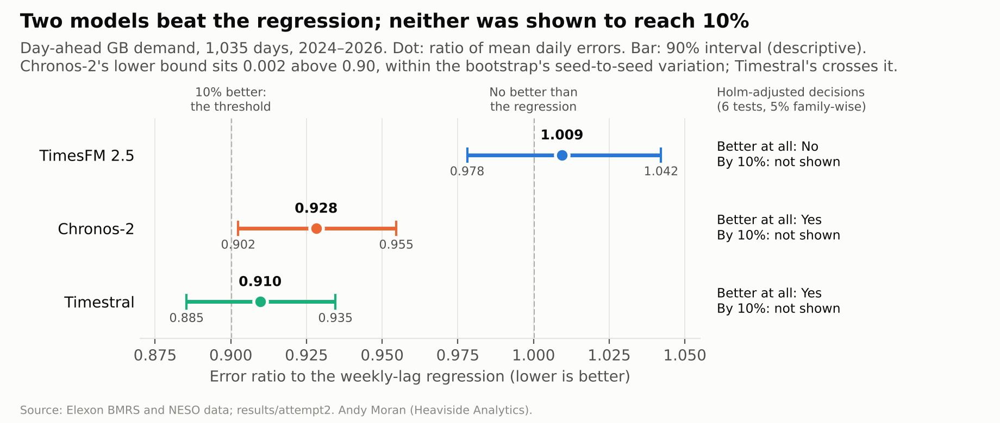

# Zero-shot foundation models on GB electricity demand

**Do zero-shot forecasting models (TimesFM 2.5, Timestral, Chronos-2) forecast GB national electricity demand a day ahead better than a simple regression, and by enough to matter? How do they compare with NESO's own published forecast?**

Andy Moran (Heaviside Analytics) · MIT licence · Results archived on Zenodo: DOI [10.5281/zenodo.23962005](https://doi.org/10.5281/zenodo.23962005)

## Result

Used zero-shot, Chronos-2 and Timestral forecast GB demand credibly better than a simple weekly-lag regression, by about 7% and 9%. Neither was shown to reach the 10% gain set in advance as the smallest worth switching for. TimesFM 2.5 was no better than the regression. NESO's forecast, which uses weather, had less than half the error of every model.

| Model | Error ratio to the regression | 90% interval | Better at all? | Better by 10%? |
| --- | --- | --- | --- | --- |
| TimesFM 2.5 | 1.009 | 0.978–1.042 | No | Not shown |
| Chronos-2 | 0.928 | 0.902–0.955 | Yes | Not shown |
| Timestral | 0.910 | 0.885–0.935 | Yes | Not shown |

Full window, 1 January 2024 to 31 October 2026 (1,035 days); six one-sided tests, Holm-adjusted. The results note, with figures, caveats and both deviations: [`RESULTS.md`](RESULTS.md) ([PDF](RESULTS.pdf)).

## What is where

| Folder or file | Contents |
| --- | --- |
| [`RESULTS.md`](RESULTS.md) | The results note |
| [`plan/`](plan/) | The preregistered plan, frozen at tag `demand-plan` (3 November 2026), its lock file, and amendment 1 (tag `demand-plan-dev1`) |
| [`deviations/`](deviations/) | The deviation log and the diagnostic for attempt 1 |
| [`code/`](code/) | Every script, with the run order in its README |
| [`results/`](results/) | Both run attempts: attempt 1 failed the validity gate; attempt 2 is the official run. Also the power check |
| [`figures/`](figures/) | The figures and the script that draws them from `results/attempt2/results.json` |
| [`docs/`](docs/) | The brief and the feasibility check |
| [`prospective/`](prospective/) | Forecasts on record before their outcomes (below) |

To reproduce the run: `code/fetch.py` downloads the inputs and checks them against the hashes in `data/fetch_manifest.json`; `code/run.py real` refuses to start unless every locked file matches. The input data are not in this repository.

## Next

- **Prospective forecasts:** the three models forecasting each day before it happens, under a short plan frozen before any prospective day is scored.
- **Weather:** the next study gives the models and the regression the same day-ahead weather forecasts, to see how much of NESO's lead they close. Daily collection of ECMWF weather forecasts for Great Britain is already running ([`prospective/weather/`](prospective/weather/)).

## The method

The same discipline as the author's macro forecasting series ([credit-impulse-realtime-prereg](https://github.com/AndyMoran/credit-impulse-realtime-prereg)):

1. **Plan first.** Every choice, including the wording of each possible result, is written down before any forecast is scored.
2. **Freeze in public.** The plan and scripts are committed and tagged; the tag's time is the evidence of timing.
3. **Run under a gate.** The official run is the first that passes pre-specified validity checks.
4. **Report everything,** in the pre-written sentences, with every deviation dated.

## Forecasts on record before their outcomes

The `prospective/` folder holds forecasts saved before the outcome they describe existed. Each day's manifest entry is pushed the same day. The evidence of timing is the push time GitHub records on its own servers (the repository's activity log), not the commit date, which the author's machine sets.

The weather manifest's first entries (forecast runs of 31 October to 2 November 2026) were collected before this repository existed and pushed afterwards: they are genuine ECMWF forecasts, verifiable by hash, but their timing is not independently evidenced. Daily pushes start on 3 November 2026.

## Data and licences

- **Elexon BMRS** (demand outturn and NESO's day-ahead forecast): "Contains BMRS data © Elexon Limited copyright and database right 2026."
- **NESO Data Portal:** "Supported by National Energy SO Open Data."
- **ECMWF open data** (CC-BY-4.0): "Contains modified Copernicus/ECMWF data." The forecast files stay on the author's machine; the manifest records their SHA-256.
- **Model weights** are not in this repository. They are downloaded at pinned revisions: TimesFM 2.5 and Chronos-2 under Apache 2.0, Timestral under Mistral's Modified MIT licence.

## Background

[`docs/background/BRIEF_2_ladder.md`](docs/background/BRIEF_2_ladder.md) sets out a longer programme this study could start: prices, forecast value, and an independent audit service. This repository covers only the demand study.

## Use of AI

The author is responsible for all design decisions, modelling runs, interpretation and final content. AI tools (including Claude, ChatGPT, Microsoft Copilot, DeepSeek, Kimi and Z.ai) were used for drafting text, writing and testing scripts, checking outputs, and sanity-checking reasoning and code. The work is designed so that AI output is never taken on trust: results are calculated numerically from the data and checked against known ground truths, and assumptions are checked against original sources. Figures were drawn throughout the work, not only for publication, to check the results for accuracy, sense and explanatory power, and to draw out nuance and mistakes. All modelling is executed by the author, who retains full responsibility for the analysis and results.
