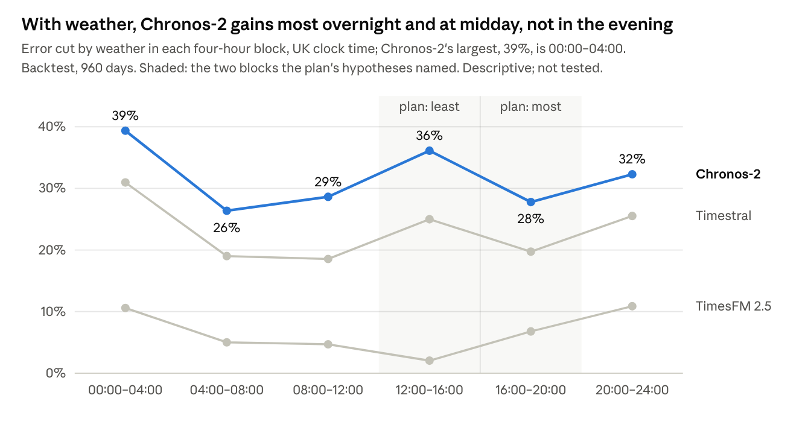

# Weather and zero-shot forecasting models: backtest results for GB electricity demand

Andy Moran (Heaviside Analytics) · 12 November 2026 · results note, part 1 of 2

DOI [10.5281/zenodo.24161799](https://doi.org/10.5281/zenodo.24161799) · ORCID [0009-0004-2194-8084](https://orcid.org/0009-0004-2194-8084) · release [`weather-results-backtest`](https://github.com/AndyMoran/gb-foundation-model-tests/releases/tag/weather-results-backtest)

Given the weather forecasts a forecaster really had at 09:30 on the day before, all four forecasters forecast GB electricity demand better, each confirmed at the study's 5% error rate over 960 backtest days. Mean daily error fell by 34% for a regression, 32% for Chronos-2, 23% for Timestral and 6% for TimesFM 2.5. These gains are measured on a backtest that overlaps the foundation models' possible training data; the clean test is the live window, which reports in April 2027. This note is the first of two: it gives the confirmatory result; the second, in April, gives the live window's descriptive check.

## Summary

- **Q1, confirmatory.** Weather improved every forecaster (error ratios 0.658 to 0.941; one-sided p < 0.0005 for each, against a level of 0.0125).
- **Q2.** Weather closed 62% of Chronos-2's gap to NESO's forecast (456 MW a day), 45% of Timestral's and 11% of TimesFM's. NESO still leads: about 700 MW of daily error against Chronos-2's 980 MW.
- **Q3.** The foundation models' 7–9% edge over the regression, found without weather, largely disappears with it: Chronos-2's error is 0.97 times the regression's, Timestral's 1.07 times.
- **Q4, descriptive.** The plan expected weather to help most in the evening and least at midday. For Chronos-2 and Timestral the backtest shows the reverse: the largest gains are overnight, and midday gains more than the rest of the day.
- **Robustness.** The answers barely change without the days that used an older forecast, without the days around ECMWF's model upgrades, or without the correction for the forecast–reanalysis mismatch. In exploratory checks after review, Chronos-2 gains at least as much on the year of days after its release, which it cannot have seen, and TimesFM 2.5 about the same.

The backtest falls in a period the models may have seen in training. A live test over winter 2026–27, which they cannot have seen, is the check on these results; it reports in April 2027.

## The study

The first study in this series (published 4 November 2026, [DOI 10.5281/zenodo.23962005](https://doi.org/10.5281/zenodo.23962005)) found that NESO's day-ahead forecast of GB demand had less than half the error of every zero-shot model tested. NESO uses weather; the models did not. This study gives all of them the same, honestly timed weather.

**The forecast.** Each day D, a forecaster issues at 09:30 UK time on D−1, from demand up to 08:30 (eight weeks of half-hours as context), for every half-hour of D. Error is the mean absolute error over D's half-hours against NESO's initial national demand outturn (INDO), in MW. Everything about the forecast without weather is the first study's, unchanged.

**The forecasters.** Three foundation models, each zero-shot at a pinned revision: Chronos-2 and Timestral, given weather over the context and the forecast day; and TimesFM 2.5, which first fits a regression on the weather within its context and then forecasts what remains. The fourth is the first study's weekly-lag regression, with temperature, its square, wind, wind chill and solar radiation added for each half-hour of the day. The pinned revisions are google/timesfm-2.5-200m-pytorch at 1d95242, amazon/chronos-2 at 29ec376 and mistralai/Timestral-209M at 9874d25 (Hugging Face). As in the first study, the forecasters see different information: the regression is refitted each day on the year to D−2 and uses demand two and seven days earlier; the models see the last eight weeks of half-hours.

**The weather.** National temperature, wind speed and solar radiation for every half-hour: temperature and wind weighted by where people live, solar by where solar panels are.

- **The forecast day** comes from ECMWF's 00:00 UTC open-data run of D−1, or of D−2 if D−1's run was not public by the issue time (186 days in summer 2025).
- **The history** comes from ERA5 up to D−11. ERA5 runs about a week behind real time, so the last ten days come from each day's own ECMWF run.
- **The mismatch** between ECMWF and ERA5 is corrected by rescaling the ERA5 part of each model's history with factors from the 60 days before D ("decision 13"). The regression is not rescaled.

**Preregistration.** The analysis plan, the weather-processing code and the backtest inputs were frozen and tagged `weather-plan` on 10 November 2026, before any model forecast demand with real weather. The backtest was scored once, on 11 November 2026, and passed all 20 of the plan's gate checks on its first attempt.

**The test.** For each forecaster, the error ratio is mean daily error with weather divided by mean daily error without, over 960 days (16 March 2024 to 31 October 2026, none excluded). It is tested one-sided against no improvement, by a moving-block bootstrap over days (blocks of 7 days, 2,000 draws, seed 20261120). The four tests share a 5% study-wide error rate, so each is held at 0.0125. Intervals are 90% percentile intervals and descriptive.

## Q1: weather improved every forecaster (confirmatory)

All four hypotheses are rejected at 0.0125. In no bootstrap draw out of 2,000 did any forecaster's ratio reach 1.

| Forecaster | Mean daily error without weather (MW) | With weather (MW) | Error ratio | 90% interval | One-sided p |
| --- | --- | --- | --- | --- | --- |
| Regression | 1,541 | 1,014 | 0.658 | 0.631–0.686 | < 0.0005 |
| Chronos-2 | 1,436 | 980 | 0.683 | 0.658–0.707 | < 0.0005 |
| Timestral | 1,409 | 1,089 | 0.773 | 0.751–0.796 | < 0.0005 |
| TimesFM 2.5 | 1,567 | 1,474 | 0.941 | 0.913–0.968 | < 0.0005 |

**Read with the leakage caveat.** The backtest overlaps the period the foundation models may have seen in training, and memory could bias the gains either way. A model that remembers GB demand forecasts well without weather and has less to gain; one that remembers how demand followed the weather may gain more than it would on days it has not seen. The live window, from 20 November 2026, contains only days after every model's weights were fixed.

In the plan's words, written before the results:

- "Over the backtest (16 March 2024 to 31 October 2026), weather improved the regression's day-ahead forecast of GB demand: mean daily error fell by 34% (error ratio 0.658; 90% interval 0.631–0.686, descriptive), confirmed at the study's 5% error rate."
- "Over the backtest (16 March 2024 to 31 October 2026), weather improved Chronos-2's day-ahead forecast of GB demand: mean daily error fell by 32% (error ratio 0.683; 90% interval 0.658–0.707, descriptive), confirmed at the study's 5% error rate." The backtest falls in a period the model may have seen in training. The prospective window, which it cannot have seen, is the descriptive check on this result.
- "Over the backtest (16 March 2024 to 31 October 2026), weather improved Timestral's day-ahead forecast of GB demand: mean daily error fell by 23% (error ratio 0.773; 90% interval 0.751–0.796, descriptive), confirmed at the study's 5% error rate." The backtest falls in a period the model may have seen in training. The prospective window, which it cannot have seen, is the descriptive check on this result.
- "Over the backtest (16 March 2024 to 31 October 2026), weather improved TimesFM 2.5's day-ahead forecast of GB demand: mean daily error fell by 6% (error ratio 0.941; 90% interval 0.913–0.968, descriptive), confirmed at the study's 5% error rate." The backtest falls in a period the model may have seen in training. The prospective window, which it cannot have seen, is the descriptive check on this result.

TimesFM 2.5 takes weather differently from the other two models: in both of its modes it estimates the weather's effect by a linear regression on its own eight-week context, rather than through the network. A gate check confirmed that the weather moves its forecasts, and the other mode gives a similar ratio (0.952). The 6% says how much TimesFM 2.5 gained from weather in this setup, not how well its architecture could use it.

## Q2: weather closes most of the gap to NESO, but not all

NESO's mean daily error over the backtest is 700 MW. Without weather the models trailed it by 709–867 MW; with weather, Chronos-2 trails by 280 MW.

| Model | Gap to NESO without weather (MW) | Reduction with weather (MW) | 90% interval (MW) | Share of the gap closed |
| --- | --- | --- | --- | --- |
| Chronos-2 | 736 | 456 | 414–500 | 62% |
| Timestral | 709 | 320 | 282–356 | 45% |
| TimesFM 2.5 | 867 | 93 | 47–140 | 11% |

- "With weather, Chronos-2's gap to NESO fell by 456 MW (90% interval 414–500, descriptive), 62% of the gap."
- "With weather, Timestral's gap to NESO fell by 320 MW (90% interval 282–356, descriptive), 45% of the gap."
- "With weather, TimesFM 2.5's gap to NESO fell by 93 MW (90% interval 47–140, descriptive), 11% of the gap."

Weather explains most of NESO's lead over the best model, but not all of it. This study cannot say what explains the rest.

## Q3: the models' edge over the regression largely disappears

Without weather, Chronos-2 and Timestral had 7–9% less error than the regression. Given the same weather, the regression gains most, and the edge shrinks or reverses.

| Model | Error ÷ regression's, with weather | 90% interval | Without weather (first study) |
| --- | --- | --- | --- |
| Chronos-2 | 0.966 | 0.931–1.001 | 0.932 |
| Timestral | 1.074 | 1.034–1.115 | 0.914 |
| TimesFM 2.5 | 1.453 | 1.394–1.510 | 1.017 |

- "With the same weather, Chronos-2's error was 0.966 times the regression's (90% interval 0.931–1.001, descriptive), against 0.932 without weather in rung 1. The regression trains on reanalysis and forecasts with ECMWF; in winter this mismatch is worth about 100–200 MW, so part of any edge may be the regression's."
- "With the same weather, Timestral's error was 1.074 times the regression's (90% interval 1.034–1.115, descriptive), against 0.914 without weather in rung 1." The same caveat applies.
- "With the same weather, TimesFM 2.5's error was 1.453 times the regression's (90% interval 1.394–1.510, descriptive), against 1.017 without weather in rung 1." The same caveat applies.

An exploratory check (E3, below) measured that mismatch: putting the regression's ECMWF inputs on ERA5's scale changes its error by 0.1% and leaves these ratios unchanged.

## Q4: weather helps most overnight and at midday, not in the evening (descriptive)

The plan predicted that weather would help more in the evening than overnight (Q4a), and less at midday than at other times (Q4b). For Chronos-2 and Timestral the backtest shows both the other way round. Those hypotheses were to be tested in the live window, so this is descriptive, and the confirmatory results are unaffected; but the plan's expectation of where weather helps was wrong for these two models.

*Source: `results/results.json`, Q4 fractional error reduction by block; 16 March 2024 to 31 October 2026.*

| Model | Evening minus overnight (points) | 90% interval | Midday minus the other five blocks (points) | 90% interval |
| --- | --- | --- | --- | --- |
| Chronos-2 | −11.6 | −15.2 to −7.8 | +5.9 | +3.3 to +8.6 |
| Timestral | −11.2 | −14.7 to −7.4 | +3.1 | +0.8 to +5.6 |
| TimesFM 2.5 | −3.8 | −7.5 to −0.3 | −5.2 | −8.3 to −1.6 |

A point is a percentage point of error cut: for Chronos-2, the evening's 27.8% less overnight's 39.4% is −11.6 points. The plan's hypotheses were set in these percentage terms. In megawatts the picture changes: midday has the largest errors and the largest cut for every forecaster but TimesFM 2.5 (see the block table below). One possible reading, untested: overnight demand responds strongly to temperature through electric heating, and at midday rooftop solar cuts the demand the grid sees, which the solar input tracks. The formal Q4 tests belonged to the live window, where they are descriptive for lack of power.

## Robustness and descriptive checks

No check changes any answer. Every ratio stays well below 1, and the ranking of the forecasters holds.

| Error ratio, with ÷ without weather | Days | Chronos-2 | Timestral | TimesFM 2.5 | Regression |
| --- | --- | --- | --- | --- | --- |
| Confirmatory: all days, rescaled history | 960 | 0.683 | 0.773 | 0.941 | 0.658 |
| Without the fallback days (older forecast run) | 774 | 0.669 | 0.761 | 0.943 | 0.638 |
| Without the days around ECMWF's model upgrades | 822 | 0.693 | 0.780 | 0.960 | 0.687 |
| History not rescaled (decision 13 off) | 960 | 0.683 | 0.774 | 0.945 | — |
| Decision 13 with a 20-day minimum | 960 | 0.683 | 0.773 | 0.941 | — |
| Decision 13 with a 45-day minimum | 960 | 0.683 | 0.773 | 0.941 | — |
| Winter days only (20 November to 31 March) | 280 | 0.624 | 0.714 | 0.875 | 0.575 |

- **The older forecast run.** On the 186 days whose newest run was released after the issue time, forecasters used the previous day's run. Without those days three of the four gains are slightly larger, as expected: a two-day-old forecast is worse. TimesFM's barely changes.
- **ECMWF's model upgrades.** Without the 138 days whose rescaling window straddles an upgrade (Cycle 49r1, November 2024; Cycle 50r1, May 2026), the gains are slightly smaller. Half of those days fall in winter, when weather helps most, as the winter row shows.
- **Rescaling the history (decision 13).** Correcting the ERA5 history for its mismatch with ECMWF changes the ratios in the third decimal place, and its minimum-days setting changes nothing visible. The three readings the plan asked for side by side (rescaled on all days, rescaled without the upgrade days, not rescaled) all point the same way.
- **TimesFM 2.5's other mode,** which forecasts first and then fits the weather to what remains: 0.952 (90% interval 0.941–0.964), close to the chosen mode's 0.941.
- **Bank holidays.** The plan predicted that weather would not close the bank-holiday gap, because that gap is the calendar. The prediction holds for all three models. Because weather helped less on the 21 bank holidays than on ordinary days, each model's holiday excess grew: for Chronos-2, from 71% to 142% more error on a bank holiday than on an ordinary day.

## Errors by block and by season (descriptive)

In megawatts, weather does most at midday, where errors are largest: Chronos-2's midday error falls by 816 MW and the regression's by 1,003 MW. By season, the gains are largest in winter for every forecaster but Timestral, and TimesFM 2.5 gains nothing in autumn.

**Mean absolute error by four-hour block, UK clock time, MW: without weather → with.**

| Block | Chronos-2 | Timestral | TimesFM 2.5 | Regression |
| --- | --- | --- | --- | --- |
| 00:00–04:00 | 862 → 523 | 851 → 588 | 1,009 → 902 | 1,072 → 725 |
| 04:00–08:00 | 1,007 → 742 | 1,004 → 813 | 1,191 → 1,132 | 1,156 → 838 |
| 08:00–12:00 | 1,760 → 1,256 | 1,733 → 1,412 | 1,869 → 1,781 | 1,920 → 1,220 |
| 12:00–16:00 | 2,259 → 1,443 | 2,207 → 1,656 | 2,333 → 2,286 | 2,361 → 1,358 |
| 16:00–20:00 | 1,566 → 1,131 | 1,512 → 1,213 | 1,683 → 1,569 | 1,583 → 1,216 |
| 20:00–24:00 | 1,162 → 787 | 1,146 → 854 | 1,315 → 1,172 | 1,153 → 729 |

Every reduction's 90% interval lies above zero except TimesFM 2.5's at midday (48 MW; −22 to 125). Overnight has the largest percentage cut but the smallest errors; midday has the largest errors and, in MW, the largest cut.

**Error ratio, with ÷ without weather, by meteorological season, pooled across years (90% interval).**

| Season | Days | Chronos-2 | Timestral | TimesFM 2.5 | Regression |
| --- | --- | --- | --- | --- | --- |
| Winter (Dec–Feb) | 180 | 0.660 (0.607–0.731) | 0.767 (0.707–0.836) | 0.849 (0.787–0.923) | 0.553 (0.494–0.622) |
| Spring (Mar–May) | 261 | 0.688 (0.650–0.733) | 0.736 (0.698–0.776) | 0.946 (0.915–0.982) | 0.708 (0.668–0.747) |
| Summer (Jun–Aug) | 276 | 0.710 (0.675–0.753) | 0.831 (0.799–0.870) | 0.923 (0.871–0.975) | 0.736 (0.693–0.783) |
| Autumn (Sep–Nov) | 243 | 0.670 (0.625–0.716) | 0.767 (0.734–0.800) | 1.030 (0.979–1.097) | 0.628 (0.578–0.676) |

In winter the regression's daily error falls by 861 MW (654 to 1,090), from 1,926 to 1,065 MW, and Chronos-2's by 560 MW (431 to 672). Summer gains are smallest for every forecaster except TimesFM 2.5, whose autumn ratio is above 1.

## Exploratory checks after review

Three checks were added after review of this note's first draft. None was in the plan, and none changes a confirmatory result. They come from the run's saved forecasts, except E3, which reruns the regression once with one input changed (`exploratory.py`).

**E1: days the models cannot have seen.** A model's weights cannot hold days after they were fixed, so the days after each model's public release are unseen by construction. The release date is an upper bound on the training cut-off, which may be earlier, so the post-release period is a conservative test.

| Model | Released | Q1 ratio before release | Days | Q1 ratio after release | Days |
| --- | --- | --- | --- | --- | --- |
| Chronos-2 | 30 October 2025 | 0.695 (0.663–0.729) | 593 | 0.664 (0.631–0.703) | 367 |
| TimesFM 2.5 | 15 September 2025 | 0.935 (0.895–0.974) | 548 | 0.948 (0.910–0.987) | 412 |
| Timestral | 15 October 2026 | 0.775 (0.753–0.798) | 943 | too few to read | 17 |

On a year of days it cannot have seen, Chronos-2 gains at least as much from weather as before its release; TimesFM 2.5's gain is about the same. Neither shows the pattern training leakage would most plausibly leave. Chronos-2's larger gain after release is not established: the two intervals overlap. Nor is it the seasons: the periods differ in mix (the pre-release period has proportionally fewer winter days and more spring and summer days), but weighting each season's ratio by each period's days predicts 0.684 before and 0.680 after, a difference of 0.004 against the 0.031 observed. The rest may be year-to-year variation; this check cannot say. Timestral has no useful unseen backtest; for it, the live window is the only check.

**E2: longer bootstrap blocks.** The plan's 7-day blocks were chosen for comparability with the first study, not for the longer dependence a 960-day backtest may carry, so they stay the primary specification and this check asks only whether the p-values are sensitive to that choice. With 14- and 28-day blocks every ratio is unchanged and every interval widens slightly. The weakest case, TimesFM 2.5 with 28-day blocks, gives 0.941 (0.903–0.975; p 0.0025), still below the 0.0125 level.

**E3: the regression's mismatch, measured.** With its ECMWF inputs put on ERA5's scale by reversing decision 13's factors, training unchanged, the regression's mean daily error is 1,015.8 MW against 1,014.4 MW as scored (ratio 1.001; 0.995–1.008). Q3 does not move: each model's error over this regression's is 0.965 for Chronos-2 (0.928–1.001), 1.072 for Timestral (1.033–1.114) and 1.451 for TimesFM 2.5 (1.392–1.510). The mismatch between forecast and reanalysis costs the regression almost nothing, so it does not explain Q3.

## Deviations, corrections and what is still to come

Nothing was changed after the tag: no data, input, forecaster, setting, window, statistic, gate or result sentence. The backtest was scored once, and it passed every gate on that first run.

**One departure from the plan's order.** The plan (Section 10) puts a single results note after 31 March 2027. This note reports the backtest now, because all four confirmatory tests are in the backtest and are final once it is scored, and because waiting would not buy a confirmatory test: by the plan's own rule, fixed before any result, the live window is descriptive, since its power to detect a 5% gain was at most 24%. Nothing in the live window depends on this note: those forecasts are made automatically by frozen code. The weather-processing code, which the plan kept private until the results, is published with this note.

**Two corrections to the frozen documents.** Neither affects any input, because the code used each day's recorded release time.

- The design brief says ECMWF moved its release to 07:34 UTC "from November 2025". The records show it moved with the run of 2 October 2025.
- The plan dates the 186 fallback days "30 March to 1 October 2025". Those are the issue days; the target days that used the older run are the following days, 31 March to 2 October 2025.

**Reporting conventions.** "p < 0.0005" means that none of the 2,000 bootstrap draws reached a ratio of 1. The results file records these as 0. The tables by block and by season were computed after the freeze by a separate script (`descriptive_tables.py`) from this run's saved forecasts, with the plan's resampling; it checks its figures against the scored results before writing, and scores nothing again. The seasons are meteorological, because the plan did not define them.

**Still to report.**

- The days from 5 to 19 November 2026. The first study's live forecasts ran from 5 November; this study's live window starts on 20 November, the day after the first daily push of weather inputs. The days between are reported separately because they came before the weather processing was frozen.
- In April 2027, the live window (20 November 2026 to 31 March 2027): every question descriptively, beside the backtest's winter-only results above. Each forecaster's live ratio will be read against this backtest by the plan's agreement rule, fixed in advance: consistent if the two 90% intervals overlap; a smaller gain if the live interval lies wholly above the backtest's, which would fit, though not prove, a backtest flattered by training leakage; a larger gain if it lies wholly below. For TimesFM 2.5, whose backtest gain is 6%, a live result showing no clear gain would be consistent with the backtest, given the window's power. For the other three, a power addendum run before any live day was scored (`power_addendum.py`, exploratory) shows the rule is sensitive: if their live gain were half the backtest's, it would read "smaller gain" in 85–100% of simulations, and with no gain in all of them. One artefact is expected: the live window is winter only, and winter gains are larger, so a live gain equal to the backtest's own winter gain reads "larger gain" in 24–79% of simulations. A "larger gain" reading will therefore be set against the backtest's winter-only ratio before it is interpreted.

## Limits

- **Training leakage.** The backtest falls in a period the foundation models may have seen in training. Memory could bias the gains either way: a model that remembers GB demand has less to gain from weather; one that remembers how demand followed the weather may gain more than on unseen days. The live window is the check; on the days after their release (E1), Chronos-2 and TimesFM 2.5 show no sign of it.
- **One weather source, three variables, one national figure.** ECMWF's open data at 0.25°, reduced to national temperature, wind and solar radiation. Better or more local weather could do more.
- **Zero-shot only.** No model was fine-tuned. The regression is the only forecaster that learns from GB data.
- **Forecast against reanalysis.** The history is ERA5 and the forecast day is ECMWF; the two differ by season and, for wind, by ECMWF's model version. The correction for this barely changed the models' results.
- **The regression is not corrected.** By design, only the models' history is put on ECMWF's scale; the regression trains on raw ERA5 and forecasts with raw ECMWF, as a forecaster trained on reanalysis would in practice. Measured afterwards (E3), the handicap is negligible: about 1 MW of daily error.
- **What it cannot show.** Why NESO still leads; what the gains are worth in money.

## Reproducibility

- **Plan and lock:** this folder holds the plan (`PLAN.md`), the power analysis (`power.py`, `power.json`), the list of ECMWF model changes (`cycle_changes.csv`) and `WEATHER_LOCK.json`, which holds the hashes of the code, inputs, weights and environments. Tag `weather-plan`, 10 November 2026.
- **Code:** the weather-processing code is public at [AndyMoran/gb-weather-private](https://github.com/AndyMoran/gb-weather-private). Its state at the tag `weather-plan` is the frozen code; `WEATHER_LOCK.json` holds the hash of every frozen file. The scripts written after the freeze (`descriptive_tables.py`, `exploratory.py`) are in the same repository, outside the lock.
- **Results:** [`results/`](results/) holds the scored run's `results.json` (lock hash beginning 0194af07), the forecasts of every forecaster for every half-hour (`forecasts.csv`), the daily errors, and the descriptive and exploratory tables. [`power_addendum.py`](power_addendum.py) and its output are the live-window power addendum.
- **Daily inputs** for the live window are pushed to `inputs/` before each target day.
- **Backtest inputs:** see [`results/README.md`](results/README.md) for where they are and how to rebuild them.

## Use of AI

I used AI tools in this work: Claude, ChatGPT, Microsoft Copilot, DeepSeek, Kimi and Z.ai. The work is designed so that results are calculated numerically and checked against ground truths, and assumptions are checked against original sources. Every gate check was shown to fail on deliberately corrupted inputs before the real data were scored.

## Sources

- Andy Moran, [Zero-shot forecasting models and GB electricity demand](https://doi.org/10.5281/zenodo.23962005), the first study, 2026
- ECMWF, [Forecast upgrade improves wind and temperature predictions](https://www.ecmwf.int/node/29231) (Cycle 49r1)
- ECMWF, [Implementation of IFS Cycle 49r1](https://confluence.ecmwf.int/spaces/FCST/pages/414584216/Implementation+of+IFS+Cycle+49r1)
- ECMWF forum, [IFS Cycle 50r1 and AIFS v2: joint implementation on 12 May 2026](https://forum.ecmwf.int/t/confirmation-ifs-cycle-50r1-and-aifs-v2-joint-implementation-on-12-may-2026/14937)
- ERA5: Copernicus Climate Change Service, Climate Data Store, hourly single levels
